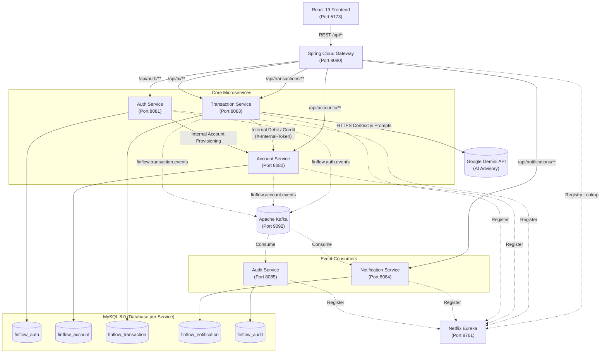

# FinFlow

**FinFlow** is an AI-powered digital banking and financial transaction platform built on a microservices architecture. It enables users to manage accounts, execute secure deposits, withdrawals, and peer-to-peer transfers, while providing intelligent spending insights and budgeting guidance grounded in real transaction data.
**Preview**:https://fin-flow-nu-eight.vercel.app/
---

## Tech Stack

| Category | Technologies |
|---|---|
| **Backend** | Java 21, Spring Boot 3.3.4, Spring Cloud 2023.0.3 (Gateway, Eureka), Spring Data JPA |
| **Frontend** | React 19, TypeScript, Vite, Tailwind CSS v4, Lucide Icons, Framer Motion |
| **Database** | MySQL 8.0 (Dedicated database per microservice) |
| **Messaging** | Apache Kafka (Distributed domain event streaming) |
| **Security** | Spring Security, JWT (Access & Refresh tokens), BCrypt, Internal Service Tokens |
| **AI / LLM** | Google Gemini API (`gemini-flash-lite-latest`), Spring 6 `RestClient` |
| **DevOps & Containers** | Docker, Docker Compose |

---

## AI Capabilities

FinFlow integrates an intelligent financial companion directly into the Transaction Service:

- **Spending Analysis & Insights (`GET /api/ai/insights`)**: Aggregates cash flow (total deposits, withdrawals, transfers sent/received, net savings) and provides practical budgeting observations based on completed transaction history.
- **Conversational Assistant (`POST /api/ai/chat`)**: Allows users to ask natural language questions about their finances, returning answers grounded strictly in verified ledger records.
- **Deterministic Math & PII Protection**: All arithmetic is computed in Java using `BigDecimal` before prompting the model to eliminate hallucinations; bank account numbers are masked (`••••1234`) for privacy.
- **Dual-Tier Resilience**: Communicates with Google Gemini via Spring 6 `RestClient`. If the API key is not configured or an upstream error occurs, the system automatically falls back to an exact rule-based summary with zero service downtime.

---

## System Architecture

FinFlow follows a database-per-service microservices pattern. Client requests pass through a centralized API Gateway that validates JWT tokens and injects verified identity headers (`X-User-Id`). Core financial operations communicate via synchronous REST, while non-blocking notifications and audit records are processed asynchronously through Apache Kafka.

### Microservices

| Service | Port | Primary Responsibility |
|---|---|---|
| **API Gateway** | `8080` | Reverse proxy, JWT authentication filter, identity header injection (`X-User-Id`), path routing |
| **Discovery Server** | `8761` | Netflix Eureka service registry and dynamic service discovery |
| **Auth Service** | `8081` | User registration, login, BCrypt password hashing, and JWT token issuance |
| **Account Service** | `8082` | Account provisioning, balance management, and row-level locking (`SELECT ... FOR UPDATE`) |
| **Transaction Service** | `8083` | Deposits, withdrawals, P2P transfer Saga with compensation refunds, idempotency, and Gemini AI |
| **Notification Service** | `8084` | Kafka consumer generating asynchronous transaction receipts and alerts |
| **Audit Service** | `8085` | Kafka consumer creating immutable compliance and audit logs across all domains |
| **Frontend** | `5173` | Responsive web interface with dark/light mode, balance overview, transfer center, and AI advisor |

### Architecture Diagram



---

## Tools

- **Languages & Frameworks**: Java 21 (LTS), Spring Boot 3.3.4, React 19, Node.js 20+
- **Build Tools**: Apache Maven (Maven Wrapper `./mvnw`), npm, Vite
- **Containers & Virtualization**: Docker, Docker Compose
- **Version Control**: Git, GitHub
- **Databases & Messaging**: MySQL 8.0, Apache Kafka 3.x, Zookeeper
- **IDE / Editors**: IntelliJ IDEA, VS Code

---

## Setup and Installation

### Prerequisites

- **Java JDK 21+** (`java -version`)
- **Docker & Docker Compose** (`docker compose version`)
- **Node.js 20+ & npm** (`node -v`)
- **Git** (`git --version`)

### 1. Clone the Repository

```bash
git clone https://github.com/Gaurav30d/FinFlow.git
cd FinFlow
```

### 2. Environment Configuration

The backend services run locally with sensible defaults, but sensitive secrets can be customized via environment variables:

| Variable | Description | Example / Default |
|---|---|---|
| `SPRING_DATASOURCE_USERNAME` | MySQL database username | `root` |
| `SPRING_DATASOURCE_PASSWORD` | MySQL database password | `root` |
| `JWT_SECRET` | 256-bit secret for signing user JWT access tokens | `your-secure-jwt-secret-min-32-chars` |
| `INTERNAL_JWT_SECRET` | Secret for internal service-to-service communication | `your-secure-internal-secret-min-32-chars` |
| `KAFKA_BOOTSTRAP_SERVERS` | Kafka broker address | `localhost:9092` |
| `GEMINI_API_KEY` | *(Optional)* Google Gemini API key for AI features | `AIzaSy...` |

### 3. Start Infrastructure Dependencies

Start MySQL, Zookeeper, and Kafka using Docker Compose:

```bash
docker compose up -d
```

Verify that all containers are running:

```bash
docker compose ps
```

*The Compose file automatically initializes MySQL on port `3306` with the required service databases: `finflow_auth`, `finflow_account`, `finflow_transaction`, `finflow_notification`, and `finflow_audit`.*

### 4. Build and Run Backend Services

Start the services in separate terminal windows in the following order:

```bash
# 1. Discovery Server (Port 8761) - Start first and wait for initialization
cd services/discovery-server && ./mvnw spring-boot:run

# 2. Core Microservices
cd services/auth-service && ./mvnw spring-boot:run          # Port 8081
cd services/account-service && ./mvnw spring-boot:run       # Port 8082
cd services/transaction-service && ./mvnw spring-boot:run   # Port 8083
cd services/notification-service && ./mvnw spring-boot:run  # Port 8084
cd services/audit-service && ./mvnw spring-boot:run         # Port 8085

# 3. API Gateway (Port 8080)
cd services/api-gateway && ./mvnw spring-boot:run
```

### 5. Start the Frontend Application

In a separate terminal:

```bash
cd services/frontend
npm install
npm run dev
```

### 6. Access the Application

- **Frontend Web UI**: [http://localhost:5173](http://localhost:5173)
- **API Gateway**: [http://localhost:8080](http://localhost:8080)
- **Eureka Service Registry**: [http://localhost:8761](http://localhost:8761)
- **Preview**: [https://fin-flow-nu-eight.vercel.app/](https://fin-flow-nu-eight.vercel.app/)
