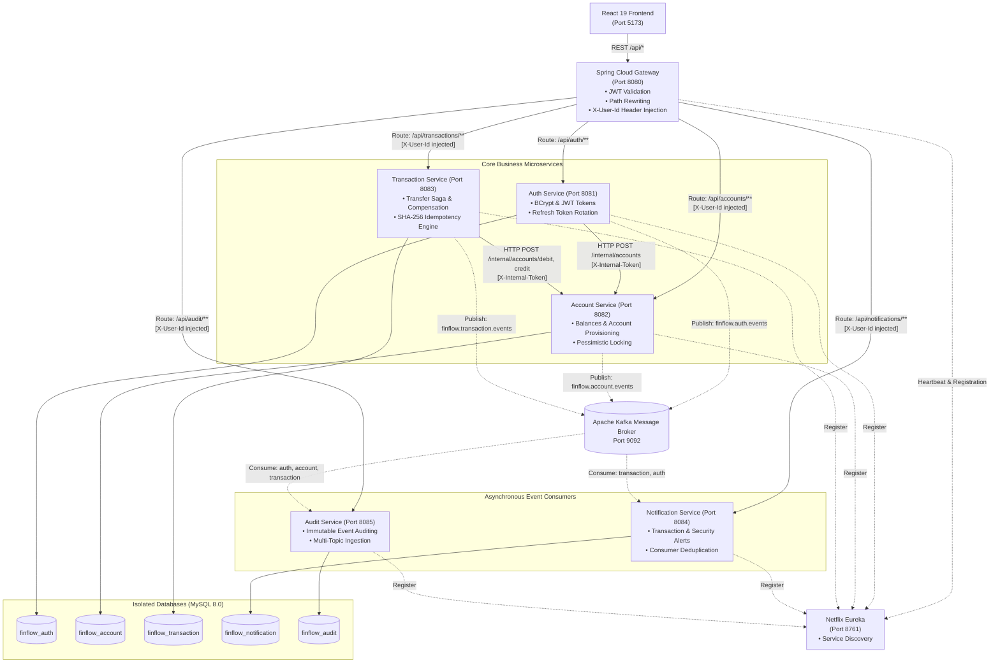
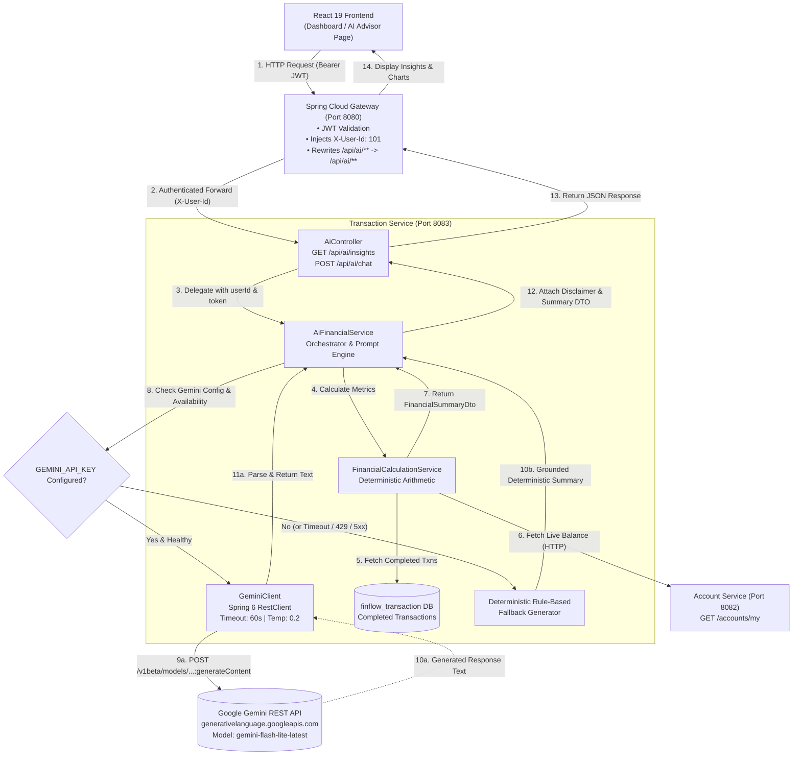

# FinFlow — Microservices-Based Financial Application

[](https://openjdk.org/)
[](https://spring.io/projects/spring-boot)
[](https://spring.io/projects/spring-cloud)
[](https://kafka.apache.org/)
[](https://www.mysql.com/)
[](https://react.dev/)
[](https://tailwindcss.com/)
[](https://www.docker.com/)

> **FinFlow** is an enterprise-grade, event-driven digital banking and financial transaction platform built with Java 21, Spring Boot microservices, Apache Kafka, and React 19. Designed with a database-per-service architecture, it addresses critical distributed systems challenges including concurrency control, idempotency, Saga-based compensating transactions, and multi-service security.

---

## Table of Contents

- [Project Overview](#project-overview)
- [Key Features](#key-features)
- [System Architecture](#system-architecture)
- [Service Responsibilities](#service-responsibilities)
- [How It Works](#how-it-works)
- [AI Implementation](#ai-implementation)
  - [AI Feature Overview](#ai-feature-overview)
  - [AI Architecture & Data Flow](#ai-architecture--data-flow)
  - [Step-by-Step Request Lifecycle](#ai-request-lifecycle)
  - [Technology & Engineering Decisions](#ai-technology--engineering-decisions)
  - [AI API Reference](#ai-api-reference)
  - [Financial Data Safety & Privacy](#financial-data-safety--privacy)
  - [AI Limitations & Roadmap](#ai-limitations--roadmap)
  - [Interview Talking Points](#ai-interview-talking-points)
- [Technology Stack](#technology-stack)
- [UI & Frontend Preview](#ui--frontend-preview)
- [Repository Structure](#repository-structure)
- [Prerequisites](#prerequisites)
- [Configuration & Environment Variables](#configuration--environment-variables)
- [Installation & Local Setup](#installation--local-setup)
- [API Overview](#api-overview)
- [Security & Reliability Architecture](#security--reliability-architecture)
- [Testing](#testing)
- [Engineering Decisions & Trade-offs](#engineering-decisions--trade-offs)
- [Documentation & Deep Dives](#documentation--deep-dives)
- [Future Improvements](#future-improvements)
- [Author & Links](#author--links)

---

## Project Overview

FinFlow provides an end-to-end digital banking platform capable of handling real-world personal finance workflows: user account provisioning, real-time balance retrieval, deposit and withdrawal operations, peer-to-peer (P2P) transfers, an immutable audit trail, automated event-driven notifications, and AI-powered financial advisory summaries.

Traditional monolithic financial applications frequently encounter tight coupling, single points of failure, and bottlenecked transaction ledgers. FinFlow solves these challenges by decomposing banking operations into autonomous microservices connected through synchronous REST contracts for core financial operations and asynchronous Apache Kafka event streams for audit and notification side-effects.

The project demonstrates production-grade distributed systems patterns:
- **Database-per-Service isolation** ensuring complete domain independence.
- **Pessimistic locking** (`SELECT ... FOR UPDATE`) preventing lost updates and race conditions during high-concurrency balance modifications.
- **Idempotent transaction processing** utilizing SHA-256 payload hashing to prevent duplicate financial execution.
- **Orchestration Saga with automated compensation** to restore user balances in the event of multi-step transfer failures.
- **Unified API Gateway** with centralized JWT authentication, path rewriting, identity header injection (`X-User-Id`), and internal service-to-service token authorization.

---

## Key Features

### 💳 Account & Financial Operations
- **Automated Account Provisioning**: Automatically creates a USD primary account with a unique account number upon user registration.
- **Atomic Balance Updates**: Supports deposits, withdrawals, and balance inquiries protected by row-level database locking.
- **Peer-to-Peer (P2P) Transfers**: Orchestrated multi-step transfers between users with atomic balance deduction and credit verification.
- **Ledger Transaction History**: Filterable, paginated transaction history with status tracking (`PENDING`, `COMPLETED`, `FAILED`, `REFUNDED`).
- **AI Financial Advisor**: Integrated Google Gemini AI to analyze spending trends and generate contextual financial guidance.

### 🔐 Authentication & Security
- **Dual-Token JWT Authentication**: 15-minute cryptographically signed Access Tokens paired with 7-day database-backed Refresh Tokens.
- **Gateway-Level Authentication**: Spring Cloud Gateway validates incoming bearer tokens before routing requests downstream.
- **Identity Header Propagation**: Strips client-supplied identity headers and injects verified `X-User-Id` downstream, enforcing zero-trust within internal microservices.
- **Internal Service-to-Service Security**: Internal balance adjustment endpoints require HMAC/shared-secret `X-Internal-Token` with `ROLE_SERVICE` authorization.
- **Password Hashing**: BCrypt hashing (10 salt rounds) for credential storage.

### ⚡ Event-Driven Architecture & Messaging
- **Domain Event Streaming**: Kafka producers emit domain events across dedicated topics (`finflow.auth.events`, `finflow.account.events`, `finflow.transaction.events`).
- **Asynchronous Notifications**: Decoupled notification service listens to transaction and security events without impacting API response times.
- **Centralized Audit Logging**: Dedicated audit service records immutable audit records for regulatory compliance across all event streams.
- **Consumer Deduplication**: Event listeners enforce idempotency using unique event ID constraints to handle at-least-once Kafka delivery.

### 🛡️ Reliability & Data Consistency
- **Pessimistic Row-Level Locking**: `PESSIMISTIC_WRITE` locks prevent concurrent double-spending on deposit, withdrawal, and transfer flows.
- **Idempotency Keys with Payload Hash Verification**: Protects against network retries by checking both the unique idempotency key and a SHA-256 hash of the request payload.
- **Compensating Transfer Saga**: If a credit operation fails during a transfer, an automated compensation workflow refunds the sender's account.

### 🎨 User Experience & Dashboard
- **Modern Responsive Interface**: Built with React 19, TypeScript, and Tailwind CSS v4.
- **Theme Support**: Seamless Dark Mode and Light Mode switching with persistent preference storage.
- **Fluid Micro-Interactions**: Floating finance doodles, interactive balance cards, and Framer Motion transitions.

*Note on Redis: Redis distributed caching and rate limiting are planned enhancements documented in the roadmap below.*

---

## System Architecture

FinFlow is structured as an event-driven microservices architecture where client interactions are routed through an API Gateway, services maintain dedicated relational schemas, and asynchronous side-effects are processed via Apache Kafka.



---

## Service Responsibilities

| Service | Port | Primary Responsibility | Key Technologies & Dependencies | Database Schema |
|---|---|---|---|---|
| **API Gateway** | `8080` | Entry point, reverse proxy, JWT bearer token validation, identity header injection (`X-User-Id`), path routing | Spring Cloud Gateway, WebFlux, Nimbus Jose JWT, Spring Cloud Eureka Client | *Stateless* |
| **Discovery Server** | `8761` | Service registry, health tracking, client-side load balancing coordination | Spring Cloud Netflix Eureka Server | *In-Memory* |
| **Auth Service** | `8081` | User registration, login, BCrypt password hashing, access/refresh token generation, account provisioning trigger | Spring Boot, Spring Security, JWT, Spring Data JPA, Kafka Producer | `finflow_auth` |
| **Account Service** | `8082` | Account lifecycle, balance inquiry, row-level pessimistic locking (`PESSIMISTIC_WRITE`), internal debit/credit execution | Spring Boot, Spring Security, Spring Data JPA, Kafka Producer | `finflow_account` |
| **Transaction Service** | `8083` | Deposit, withdrawal, P2P transfer Saga orchestration, compensation refund logic, SHA-256 idempotency verification, Gemini AI advisor | Spring Boot, Spring Data JPA, Feign/WebClient, Google Gemini AI API, Kafka Producer | `finflow_transaction` |
| **Notification Service** | `8084` | Asynchronous transaction receipts and security alerts, consumer-side deduplication | Spring Boot, Spring Data JPA, Spring Kafka Consumer | `finflow_notification` |
| **Audit Service** | `8085` | Regulatory and compliance logging, immutable historical record ingestion across all domains | Spring Boot, Spring Data JPA, Spring Kafka Consumer | `finflow_audit` |
| **Frontend** | `5173` | User interface, auth state management, theme switching, transaction forms, ledger view, AI insights | React 19, TypeScript, Vite, Tailwind CSS v4, Lucide Icons, Framer Motion | *Browser LocalStorage* |

---

## How It Works

### 1. User Registration & Account Provisioning
1. Client submits registration details (`POST /api/auth/register`) through the API Gateway.
2. `auth-service` validates input, hashes password using BCrypt (10 rounds), and persists the user record in `finflow_auth`.
3. `auth-service` executes a synchronous internal HTTP call (`POST /internal/accounts`) with an `X-Internal-Token` header to `account-service` to provision the user's initial USD account.
4. An `AuthEvent` (`USER_REGISTERED`) is published to the `finflow.auth.events` Kafka topic for asynchronous notification and audit logging.

### 2. Authenticated Request Flow
1. Client logs in (`POST /api/auth/login`) and receives a short-lived Access Token (15 min) and Refresh Token (7 days).
2. For subsequent requests, the client passes `Authorization: Bearer <token>` to the API Gateway (`:8080`).
3. Gateway validates JWT signature and expiration. If valid, it extracts the `userId` claim, strips any existing `X-User-Id` request headers to prevent spoofing, and injects `X-User-Id: <userId>` into the downstream request.
4. Downstream microservices read `X-User-Id` directly, avoiding redundant database lookups or re-decoding.

### 3. Concurrency-Safe Account Operations
1. When balance operations (deposit, withdrawal, or transfer) occur, `account-service` queries the database using pessimistic write locking:
   ```sql
   SELECT * FROM accounts WHERE id = ? FOR UPDATE;
   ```
2. Any concurrent transactions targeting the same account wait until the active database transaction commits, eliminating race conditions and double-spending.

### 4. P2P Transfer Saga & Compensation
Transfers span multiple user accounts across the `transaction-service` and `account-service`:
1. **Idempotency Check**: `transaction-service` checks if the `Idempotency-Key` was previously processed. If present, it verifies the SHA-256 hash of the request payload to prevent payload tampering and returns the cached response.
2. **Debit Sender**: `transaction-service` invokes `account-service` (`POST /internal/accounts/debit`). The sender's balance is locked and deducted.
3. **Credit Receiver**: `transaction-service` invokes `account-service` (`POST /internal/accounts/credit`).
4. **Compensation Workflow**: If the credit call fails (network timeout, invalid recipient), `transaction-service` triggers a compensating refund (`POST /internal/accounts/credit` to sender) and marks the transaction status as `REFUNDED`.
5. **Event Publication**: On completion, a `TransactionEvent` (`TRANSFER_COMPLETED`) is published to `finflow.transaction.events`.

### 5. Asynchronous Audit & Notification Streaming
1. Both `notification-service` and `audit-service` subscribe to Kafka topics with distinct consumer groups (`finflow-notification-group`, `finflow-audit-group`).
2. Consumers store processed event IDs in unique database columns. If an event is re-delivered due to Kafka rebalancing, the unique constraint catches the duplicate and safely discards it without double-processing.

> 📖 **Deep Dive Reference**: For comprehensive sequence diagrams, thread-safety analysis, and failure mode analysis, refer to [`preparation.md`](./preparation.md).

---

---

## AI Implementation

FinFlow includes a native, production-grade financial intelligence engine built directly into the microservices architecture. Unlike systems that treat AI as an afterthought or a chatbot widget, FinFlow pairs deterministic financial arithmetic with Google Gemini LLM reasoning to deliver context-aware spending summaries, cash-flow diagnostics, and conversational financial assistance.

### AI Feature Overview

Personal banking applications frequently overwhelm users with rows of raw transactional data without providing actionable context. FinFlow AI bridges this gap by transforming ledger entries into grounded, plain-English budgeting intelligence.

- **Financial Problem Solved**: Users struggle to evaluate their overall monthly net savings rate, understand where outflows concentrate, or detect subtle cash-flow deficits across multiple transfers, deposits, and withdrawals.
- **Who Benefits**: Retail banking users seeking real-time budgeting feedback, instant answers to transaction queries, and automated financial health assessments.
- **Data Consumed**: Strictly aggregated metrics computed from verified database records (total inflow, total outflow, net cash flow, completed transaction counts, live account balance, and masked recent transactions).
- **Result Produced**: Two primary interfaces:
  1. **Automated Financial Insights (`GET /api/ai/insights`)**: Returns a consolidated financial summary paired with natural language observations and actionable budgeting suggestions.
  2. **Conversational AI Financial Assistant (`POST /api/ai/chat`)**: Allows users to ask natural language questions (e.g., *"How much did I spend this week?"*, *"Is my net cash flow positive?"*) grounded in their ledger records.
- **Service Integration**: Embedded as a dedicated package (`com.finflow.transactionservice.ai`) within `transaction-service`, exposed through the API Gateway at `/api/ai/**`, and surfaced in the React frontend via dashboard summary cards and a dedicated advisor page.
- **Implementation Status**: **Fully Implemented with Dual-Tier Fallbacks**. If an external LLM key is configured, the system provides generative natural-language guidance; if unconfigured or if upstream connectivity fails, the engine gracefully falls back to deterministic rule-based calculation with zero service downtime.

---

### AI Architecture & Data Flow

The AI subsystem operates within `transaction-service`, relying on synchronous internal communication with `account-service` for live balance inquiries and direct repository access to completed transactions.



---

### Step-by-Step Request Lifecycle

1. **User Initiation**: A user loads their dashboard (triggering an automated background fetch for `/api/ai/insights`) or enters a query into the AI Advisor chat input (`/api/ai/chat`).
2. **Gateway Ingress & Validation**: The Spring Cloud Gateway interceptor validates the client's JWT signature and expiration. It extracts the `userId` claim, strips any existing `X-User-Id` headers to prevent identity spoofing, injects the verified `X-User-Id: <userId>`, and routes the request to `lb://transaction-service`.
3. **Controller Authentication**: `AiController` receives the request. The Spring Security context resolves the authenticated `userId` principal (`Long userId = (Long) authentication.getPrincipal()`). For chat requests, Bean Validation enforces `@NotBlank` on the prompt.
4. **Deterministic Ledger Retrieval**: `AiFinancialService` delegates to `FinancialCalculationService`. It queries the `TransactionRepository` for transactions where `status = COMPLETED` ordered by `createdAt DESC`.
5. **Live Balance Query**: If an authorization token is present, `FinancialCalculationService` invokes `account-service` via `AccountClient.getMyAccount(token)` to fetch the authoritative live balance and currency (defaulting to `INR`).
6. **Data Aggregation & PII Sanitization**:
   - Total deposits, withdrawals, transfers sent, and transfers received are accumulated using `BigDecimal` arithmetic.
   - Net cash flow is calculated as `totalInflow - totalOutflow`.
   - Account numbers in recent transactions are masked (e.g., `••••4821`) using `maskAccountNumber()` to ensure full PII protection before any prompt generation.
7. **Prompt Construction with Guardrails**: `AiFinancialService` constructs a context block containing the computed financial metrics and pairs it with an immutable system instruction:
   ```text
   You are FinFlow AI, a financial intelligence assistant powered by Google Gemini.
   CRITICAL RULES:
   1. Base your answer strictly on the user's provided financial metrics and completed transactions.
   2. Do NOT invent transactions, merchants, or categories that do not exist in the data.
   3. Do NOT execute, simulate, or claim to execute transfers, deposits, withdrawals, or SQL commands.
   4. If data is insufficient or absent, state so clearly without guessing.
   5. Provide helpful, encouraging, and actionable budgeting observations.
   6. Keep your answers concise, clear, and well-structured.
   ```
8. **Upstream Model Invocation**: `GeminiClient` sends a POST request to Google Gemini's REST endpoint (`https://generativelanguage.googleapis.com/v1beta/models/{model}:generateContent`) with:
   - Header: `x-goog-api-key: ${GEMINI_API_KEY}`
   - Model: Configured via `GEMINI_MODEL` (defaults to `gemini-flash-lite-latest`; automatically upgrades sunset models like `gemini-1.5-flash`).
   - Generation Config: `temperature: 0.2` (low temperature to enforce grounded, deterministic responses).
   - HTTP Client: Configured with a `60,000ms` connect and read timeout.
9. **Resilient Fallback Handling**:
   - If `GEMINI_API_KEY` is not set, the system bypasses the network call and returns `buildRuleBasedSummary(summary)` with a clear notice.
   - If the API returns HTTP 401/403 (`AUTHENTICATION_ERROR`), HTTP 429 (`QUOTA_EXCEEDED`), HTTP 5xx (`UPSTREAM_SERVER_ERROR`), or a network timeout, `GeminiException` is caught. The system logs a diagnostic message and returns the deterministic financial summary so the user experience never breaks.
10. **Delivery & Presentation**: The response is bundled with the structured `FinancialSummaryDto` and a statutory disclaimer:
    > *"This financial analysis is for informational purposes only and does not constitute regulated financial advice."*
    The React frontend renders the response with visual breakdown cards and conversational message bubbles.

---

### AI Technology & Engineering Decisions

| Dimension | Implementation Details | Architectural Rationale |
|---|---|---|
| **AI Approach** | Retrieval-Augmented Grounding (RAG-lite) + Deterministic Fallback | Ensures the model only comments on real database transactions. Zero hallucinated balances. |
| **Model / Provider** | Google Gemini (`gemini-flash-lite-latest` / `gemini-2.0-flash`) | Low latency, cost-effective inference, and high adherence to structured system instructions. |
| **Integration Layer** | Spring 6 `RestClient` + `SimpleClientHttpRequestFactory` | Eliminates heavy external SDK dependencies; native Spring timeout and HTTP exchange management. |
| **Model Auto-Upgrade** | Transparent string sanitizer in `GeminiClient` constructor | Automatically upgrades retired or sunset model strings (e.g. `gemini-1.5-flash`) to active live models without requiring code changes. |
| **Temperature** | `0.2` | Minimizes creative hallucination and guarantees factual consistency with ledger numbers. |
| **Data Separation** | Calculations done in Java `BigDecimal`, not by the LLM | LLMs are notorious for arithmetic errors. FinFlow computes all totals in Java and gives the LLM the pre-computed answers. |
| **PII Protection** | Automatic account masking (`••••XXXX`) | Prevents full account numbers from leaving the secure service perimeter. |
| **Timeout & Resilience** | Configurable `60,000ms` timeout + typed exception mapping | Prevents upstream Google API stalls from locking HTTP worker threads in the transaction service. |
| **Unit & Mock Testing** | Mockito unit tests in `AiFinancialServiceTest` and `GeminiClientTest` | Verifies unconfigured keys, upstream 500 errors, network timeouts, and blank prompts without incurring API charges. |

---

### AI API Reference

#### 1. Retrieve Financial Insights
Returns a comprehensive spending breakdown, computed inflow/outflow metrics, and AI-generated budgeting advice.

- **Endpoint**: `GET /api/ai/insights`
- **Authentication**: `Bearer <Access-Token>`
- **Sample Response (`200 OK`)**:
```json
{
  "summary": {
    "totalInflow": 50000.00,
    "totalOutflow": 18500.00,
    "netCashFlow": 31500.00,
    "totalDeposits": 50000.00,
    "totalWithdrawals": 3500.00,
    "totalTransfersSent": 15000.00,
    "totalTransfersReceived": 0.00,
    "completedTransactionCount": 6,
    "currentBalance": 31500.00,
    "currency": "INR",
    "hasTransactions": true,
    "recentTransactions": [
      {
        "transactionReference": "TXN-8F9E2A1B",
        "type": "TRANSFER_SENT",
        "amount": 15000.00,
        "currency": "INR",
        "description": "Transfer sent to account ••••4821",
        "createdAt": "2026-10-28T09:42:15"
      }
    ]
  },
  "insights": "You have maintained a strong financial posture with a positive net cash flow of ₹31,500.00 this period. Your primary outflow was a transfer of ₹15,000.00. Since your savings rate exceeds 60% of total inflows, you might consider allocating a portion of your liquid balance into long-term savings or emergency reserves.",
  "disclaimer": "This financial analysis is for informational purposes only and does not constitute regulated financial advice."
}
```

#### 2. Conversational Financial Q&A
Allows the authenticated user to ask arbitrary natural language questions about their financial activity.

- **Endpoint**: `POST /api/ai/chat`
- **Authentication**: `Bearer <Access-Token>`
- **Request Body**:
```json
{
  "question": "What percentage of my income did I spend, and how much is left?"
}
```
- **Sample Response (`200 OK`)**:
```json
{
  "question": "What percentage of my income did I spend, and how much is left?",
  "answer": "Based on your completed records, your total inflow was ₹50,000.00 and total outflow was ₹18,500.00, meaning you have spent approximately 37% of your total inflow. You currently have an available balance of ₹31,500.00 remaining.",
  "groundedSummary": {
    "totalInflow": 50000.00,
    "totalOutflow": 18500.00,
    "netCashFlow": 31500.00,
    "currentBalance": 31500.00,
    "currency": "INR",
    "completedTransactionCount": 6
  },
  "disclaimer": "This financial analysis is for informational purposes only and does not constitute regulated financial advice."
}
```

---

### Financial Data Safety & Privacy

FinFlow follows strict financial security principles regarding AI integrations:

1. **Zero Financial Mutation Privileges**:
   - The AI subsystem has **read-only access**. There are no tool-calling definitions, function bindings, or database write pathways allowing the AI model to initiate transfers, debit balances, or modify transaction statuses.
   - The system prompt explicitly forbids the model from claiming or attempting transaction execution.
2. **Deterministic Computation**:
   - Financial totals (inflow, outflow, net savings, transaction counts) are calculated in Java using `BigDecimal` before the prompt is created.
   - The LLM is used solely for natural-language synthesis and advice; it is never asked to perform arithmetic on user money.
3. **Data Minimization & PII Masking**:
   - User names, passwords, email addresses, and full bank account numbers are **never sent** to Google Gemini.
   - Account numbers are systematically masked (`••••XXXX`) before inclusion in prompt context.
4. **Defense-in-Depth Authorization**:
   - Requests must pass Gateway JWT verification.
   - Downstream queries strictly filter by `userId` resolved from the cryptographic token (`findByUserIdAndStatusOrderByCreatedAtDesc(userId, COMPLETED)`). Users can never access or query another customer's financial records.
5. **No Secret Leakage**:
   - API keys are injected via environment variables (`GEMINI_API_KEY`) and sanitized in memory. Error handlers catch upstream HTTP 4xx/5xx responses and sanitize exception messages to prevent key exposure in logs.

---

### AI Limitations & Roadmap

While the current implementation provides robust financial intelligence, the following enhancements represent sensible production extensions:

- [ ] **Multi-Turn Conversation Memory**: Current chat interactions are stateless single-turn exchanges. Adding Redis-backed conversation session history will enable follow-up questions (e.g., *"Why did that transfer cost so much?"*).
- [ ] **Automated Category Tagging**: Enrich ledger items with merchant category codes (MCC) or semantic classification (e.g. Groceries, Utilities, Rent) prior to AI analysis.
- [ ] **Token Bucket Rate Limiting at Gateway**: Apply dedicated Spring Cloud Gateway rate limiting specifically to `/api/ai/**` routes to prevent Gemini API quota exhaustion.
- [ ] **Semantic Response Caching with Redis**: Cache generated monthly spending summaries using hashes of the user's transaction ledger state, reducing duplicate LLM calls when transaction history has not changed.

---

### Interview Talking Points

When discussing FinFlow's AI implementation in an engineering interview, be prepared to emphasize these key architectural decisions:

1. **Why avoid delegating math to an LLM?**
   > *"LLMs are probabilistic pattern matchers, not calculation engines. In FinFlow, `FinancialCalculationService` computes all balances and inflows using Java `BigDecimal` with 100% precision. The LLM only receives pre-calculated facts, eliminating arithmetic hallucination."*

2. **How does the system maintain high availability when the LLM is down?**
   > *"We implemented a dual-tier fallback mechanism. If Google Gemini experiences a timeout, rate limit (HTTP 429), or is unconfigured, `AiFinancialService` catches `GeminiException` and instantly returns a grounded, deterministic summary generated from live SQL records with zero downtime."*

3. **How is customer financial privacy protected with external AI APIs?**
   > *"We practice strict data minimization. The AI prompt contains zero personal identifiers: emails, user IDs, and names are excluded, and account numbers are masked (`••••4821`). The LLM is completely isolated in a read-only role with no mutation capabilities."*

4. **Why use Spring 6 RestClient instead of an external SDK?**
   > *"Using Spring 6's native `RestClient` allows us to keep the microservice lightweight, configure connection and read timeouts explicitly, and handle HTTP status codes cleanly without introducing heavy vendor SDK dependencies."*


## Technology Stack

| Category | Technology | Version | Purpose in FinFlow |
|---|---|---|---|
| **Language** | Java | 21 (LTS) | Core backend services, modern pattern matching, records, and virtual thread readiness |
| **Framework** | Spring Boot | 3.3.4 | Microservice bootstrapping, dependency injection, and REST controllers |
| **API Gateway** | Spring Cloud Gateway | 2023.0.3 | Reactive reverse proxy, JWT validation, path rewriting, identity injection |
| **Service Discovery** | Netflix Eureka | 2023.0.3 | Dynamic service registration and client-side load balancing |
| **Security** | Spring Security & JWT | 6.x / Nimbus | Stateless authentication, BCrypt hashing, internal service token authorization |
| **Persistence** | Spring Data JPA / Hibernate | 6.x | ORM, repository abstractions, pessimistic database row locking |
| **Database** | MySQL | 8.0 | Isolated relational persistence per microservice |
| **Event Broker** | Apache Kafka | 3.x / Bitnami | Asynchronous domain event streaming, decoupling notifications and audits |
| **AI Integration** | Google Gemini API | 1.5 Flash | Context-aware personal spending insights and financial summaries |
| **Frontend** | React & Vite | React 19 / Vite 6 | High-performance single-page frontend application |
| **Frontend Styling** | Tailwind CSS & Framer Motion | v4 / v12 | Adaptive dark/light theme, custom financial animations and doodles |
| **Containerization** | Docker & Docker Compose | Compose v2 | Local infrastructure orchestration for MySQL, Zookeeper, and Kafka |

---

## UI & Frontend Preview

The FinFlow frontend offers a dark/light responsive interface designed for personal financial control.

| View | Capabilities |
|---|---|
| **Executive Dashboard** | Real-time aggregate balance, active account status, visual income/expense summary charts, and quick-action deposit/transfer modals. |
| **Transfer & Payment Center** | Concurrency-protected fund transfers with instant client-side recipient validation, idempotency tagging, and fee preview. |
| **Ledger & History** | Chronological transaction ledger with status tags (`COMPLETED`, `PENDING`, `FAILED`, `REFUNDED`), search filters, and transaction receipt modal. |
| **AI Financial Advisor** | Real-time context generation summarizing recent debit/credit habits and suggesting budgeting recommendations via Gemini. |

> 📷 *Screenshots and visual UI walkthroughs can be captured by running the frontend locally (see [Installation & Local Setup](#installation--local-setup)). UI assets and floating doodle animations are located in `services/frontend/src/`.*

---

## Repository Structure

```text
FinFlow/
├── services/
│   ├── api-gateway/              # Spring Cloud Gateway (Port 8080) - JWT filter & routing
│   ├── discovery-server/         # Netflix Eureka Registry (Port 8761)
│   ├── auth-service/             # Authentication & user provisioning (Port 8081)
│   ├── account-service/          # Account management & row-locked balance engine (Port 8082)
│   ├── transaction-service/      # Transfer Saga, idempotency engine & AI advisor (Port 8083)
│   ├── notification-service/     # Kafka consumer for transaction & security alerts (Port 8084)
│   ├── audit-service/            # Kafka consumer for immutable compliance records (Port 8085)
│   ├── frontend/                 # React 19 + TypeScript + Vite + Tailwind CSS v4 (Port 5173)
│   ├── test_e2e_integration.py   # Full automated end-to-end integration test suite
│   ├── test_security_audit.py    # Dedicated security and boundary verification script
│   └── preparation.md            # Comprehensive 20-section interview preparation guide
├── docker-compose.yml            # Infrastructure orchestration (MySQL 8.0, Zookeeper, Kafka)
├── architecture.md               # Architecture design notes
├── implementation.md             # Implementation specifications
├── phaseA.md                     # Initial phase deliverables
└── README.md                     # Root project documentation
```

---

## Prerequisites

Before running FinFlow locally, ensure you have the following installed:

- **Java Development Kit (JDK)**: Version 21 or higher (`java -version`)
- **Node.js**: Version 20 or higher & `npm` (`node -v`)
- **Docker & Docker Compose**: Docker Desktop or Docker Engine v20+ (`docker compose version`)
- **Python 3**: Version 3.10+ (optional, required only for running integration test scripts)
- **Apache Maven**: Optional; services contain the Maven Wrapper (`./mvnw`)

---

## Configuration & Environment Variables

FinFlow separates configuration from code. Key variables can be supplied through environment variables or configured in local properties files.

### Critical Environment Variables

| Variable | Service(s) | Purpose | Example / Default |
|---|---|---|---|
| `SPRING_DATASOURCE_USERNAME` | All Backend Services | MySQL database username | `root` |
| `SPRING_DATASOURCE_PASSWORD` | All Backend Services | MySQL database password | `root` |
| `JWT_SECRET` | Gateway, Auth Service | 256-bit secret used for signing and verifying user access tokens | *Replace with a secure random string (min 32 chars)* |
| `INTERNAL_JWT_SECRET` | Auth, Account, Transaction | Shared secret for inter-service HTTP communication (`X-Internal-Token`) | *Replace with a secure internal token* |
| `KAFKA_BOOTSTRAP_SERVERS` | Auth, Account, Txn, Notif, Audit | Kafka broker connection endpoint | `localhost:9092` |
| `GEMINI_API_KEY` | Transaction Service | Google Gemini AI API key for financial advisory insights | `AIzaSy...` *(optional)* |

> ⚠️ **Security Warning**: Never commit actual secrets or `.env` files containing production credentials to source control. For local development, set these in your shell environment or a `.env` file that is excluded in `.gitignore`.

---

## Installation & Local Setup

### Step 1: Clone the Repository
```bash
git clone https://github.com/Gaurav30d/FinFlow.git
cd FinFlow
```

### Step 2: Start Infrastructure with Docker Compose
Start MySQL, Zookeeper, and Kafka containers:
```bash
docker compose up -d
```
Verify that all containers are healthy:
```bash
docker compose ps
```

*The `docker-compose.yml` automatically initialises the MySQL container on port `3306` with databases: `finflow_auth`, `finflow_account`, `finflow_transaction`, `finflow_notification`, and `finflow_audit`.*

### Step 3: Start the Discovery Server
Open a terminal and start the Eureka registry first:
```bash
cd services/discovery-server
./mvnw spring-boot:run
```
*Wait until Eureka starts at `http://localhost:8761`.*

### Step 4: Start the Core Backend Services
In separate terminal tabs, start the microservices in the following recommended order:

```bash
# 1. Auth Service (Port 8081)
cd services/auth-service && ./mvnw spring-boot:run

# 2. Account Service (Port 8082)
cd services/account-service && ./mvnw spring-boot:run

# 3. Transaction Service (Port 8083)
cd services/transaction-service && ./mvnw spring-boot:run

# 4. Notification Service (Port 8084)
cd services/notification-service && ./mvnw spring-boot:run

# 5. Audit Service (Port 8085)
cd services/audit-service && ./mvnw spring-boot:run

# 6. API Gateway (Port 8080)
cd services/api-gateway && ./mvnw spring-boot:run
```

### Step 5: Start the Frontend Application
In a new terminal window:
```bash
cd services/frontend
npm install
npm run dev
```

Open your browser and navigate to `http://localhost:5173`.

---

## API Overview

All client requests route through the **API Gateway** on port `8080`. The Gateway rewrites paths and validates credentials before dispatching calls to internal microservices.

### Public Endpoints (No Authentication Required)

| Method | Gateway Endpoint | Target Service | Description |
|---|---|---|---|
| `POST` | `/api/auth/register` | `auth-service` | Register a new user and provision default account |
| `POST` | `/api/auth/login` | `auth-service` | Authenticate credentials; returns access & refresh tokens |
| `POST` | `/api/auth/refresh` | `auth-service` | Exchange valid refresh token for a new access token |

### Protected Endpoints (Requires `Authorization: Bearer <JWT>`)

| Method | Gateway Endpoint | Target Service | Description |
|---|---|---|---|
| `GET` | `/api/accounts/my` | `account-service` | Retrieve authenticated user's accounts and current balances |
| `GET` | `/api/accounts/{id}` | `account-service` | Retrieve specific account details (enforces user ownership) |
| `POST` | `/api/transactions/deposit` | `transaction-service` | Execute balance deposit (pessimistic lock on account) |
| `POST` | `/api/transactions/withdraw` | `transaction-service` | Execute balance withdrawal (validates sufficient funds) |
| `POST` | `/api/transactions/transfer` | `transaction-service` | P2P transfer Saga with compensation refund support |
| `GET` | `/api/transactions/my` | `transaction-service` | Retrieve paginated transaction history for authenticated user |
| `GET` | `/api/transactions/ai-advice` | `transaction-service` | Request AI-generated spending insights via Google Gemini |
| `GET` | `/api/notifications/my` | `notification-service` | Retrieve user notification history |
| `GET` | `/api/audit/my` | `audit-service` | View user security and audit activity |

### Internal Service Endpoints (Protected by `X-Internal-Token`)
*These endpoints are restricted to inter-service communication and are blocked from external client routing at the gateway:*
- `POST /internal/accounts`: User account provisioning
- `POST /internal/accounts/debit`: Deduct funds during transfer
- `POST /internal/accounts/credit`: Credit funds during transfer or compensation refund

> 📋 *Complete request/response JSON schemas, error codes, and curl examples are documented in [`preparation.md`](./preparation.md).*

---

## Security & Reliability Architecture

```
Client Request
      │
      ▼
┌────────────────────────────────────────────────────────┐
│               Spring Cloud API Gateway                 │
│  1. Check Bearer Token                                 │
│  2. Validate JWT signature & expiry                    │
│  3. Strip inbound X-User-Id (Prevent header spoofing)  │
│  4. Extract userId from claims                         │
│  5. Inject clean X-User-Id: <userId> downstream        │
└──────────────────────────┬─────────────────────────────┘
                           │ Authenticated HTTP
                           ▼
┌────────────────────────────────────────────────────────┐
│            Downstream Microservice (e.g. Txn)          │
│  1. Read X-User-Id header directly                     │
│  2. Check Idempotency-Key & SHA-256 payload hash       │
│  3. Invoke Account Service with X-Internal-Token       │
└──────────────────────────┬─────────────────────────────┘
                           │ Internal HTTP
                           ▼
┌────────────────────────────────────────────────────────┐
│                    Account Service                     │
│  1. Verify X-Internal-Token                            │
│  2. SELECT * FROM accounts WHERE id = ? FOR UPDATE     │
│  3. Verify balance >= debit amount                     │
│  4. Update balance & commit database lock              │
└────────────────────────────────────────────────────────┘
```

1. **Defense-in-Depth Identity Propagation**: Gateway authenticates tokens once at the edge and safely injects trusted `X-User-Id` downstream, removing the overhead of redundant token decoding from internal services.
2. **Internal API Protection**: Internal balance debit/credit routes require a pre-shared cryptographic internal token (`X-Internal-Token`). External requests attempting to reach `/internal/**` are dropped at the gateway.
3. **Pessimistic Concurrency Locking**: Prevents race conditions and double-spending across simultaneous operations targeting the same balance.
4. **Idempotency with Cryptographic Integrity**: Stored idempotency keys are linked to a SHA-256 hash of the request body. If a client attempts to reuse a key with altered parameters, the request is rejected with `409 Conflict`.
5. **Consumer At-Least-Once Deduplication**: Kafka consumers enforce idempotency by inserting the event ID into a dedicated table with a `UNIQUE` constraint, guaranteeing that repeated Kafka deliveries will not create duplicate ledger records.

---

## Testing

FinFlow includes unit tests, MockMvc controller tests, Kafka consumer tests, and automated Python integration test suites.

### Running Unit & Service Tests
Run standard Maven test suites across any individual microservice:
```bash
# Example: Running Account Service tests
cd services/account-service
./mvnw clean test
```

### Running the End-to-End Integration Suite
A comprehensive Python script (`services/test_e2e_integration.py`) tests the entire lifecycle through the API Gateway:
- User registration and account provisioning verification.
- Login and JWT token issuance.
- Balance inquiry.
- Concurrent deposit and withdrawal operations.
- P2P transfer between two test users.
- Idempotency replay check.
- Notification and audit event verification.

```bash
# Ensure all backend services and infrastructure are running, then:
python3 services/test_e2e_integration.py
```

### Running Security & Boundary Tests
A dedicated security test script (`services/test_security_audit.py`) validates defense-in-depth controls:
- Spoofed `X-User-Id` header rejection.
- Unauthorized access to internal `/internal/**` endpoints.
- Access token expiration and invalid signature handling.
- Negative amount validation on financial transactions.

```bash
python3 services/test_security_audit.py
```

---

## Engineering Decisions & Trade-offs

### 1. Microservices vs. Modular Monolith
- **Decision**: Decouple banking domains into autonomous services with independent schemas (`finflow_auth`, `finflow_account`, `finflow_transaction`, `finflow_notification`, `finflow_audit`).
- **Trade-off**: Increases operational complexity (distributed tracing, service discovery, multi-service deployment) in exchange for independent deployability, fault isolation, and technology flexibility.

### 2. Orchestration Saga vs. Distributed Two-Phase Commit (2PC / XA)
- **Decision**: Use an Orchestration Saga inside `transaction-service` with automated compensation refunds instead of 2PC.
- **Trade-off**: 2PC provides ACID transactions across databases but introduces severe database connection locking and poor scalability under network partitions. The Saga pattern trades immediate consistency for high availability and eventual consistency.

### 3. Pessimistic Locking vs. Optimistic Locking
- **Decision**: Implement `PESSIMISTIC_WRITE` (`SELECT ... FOR UPDATE`) in `account-service` for balance modifications.
- **Trade-off**: Optimistic locking (`@Version`) avoids database locks but causes frequent retry exceptions and aborted transactions during high-frequency balance adjustments. Pessimistic locking queues competing operations cleanly at the database level.

### 4. Hybrid Synchronous REST + Asynchronous Kafka
- **Decision**: Core financial transactions (debit, credit, transfer) use synchronous HTTP for immediate user feedback. Non-critical side-effects (audit logs, user alerts) are emitted to Kafka.
- **Trade-off**: Balances user need for immediate balance confirmation with the high throughput and decoupled resilience of message queues for downstream consumers.

---

## Documentation & Deep Dives

For detailed implementation guides, system diagrams, and interview walkthroughs:

- 📘 **[`preparation.md`](./preparation.md)**: **The Complete FinFlow Interview Preparation Guide**. Includes 20 comprehensive sections covering end-to-end request lifecycles, database locking deep dives, Kafka event architectures, Saga failure scenarios, and 50+ technical interview questions with answers.
- 📐 **[`architecture.md`](./architecture.md)**: System design notes and architectural specifications.
- 🛠️ **[`implementation.md`](./implementation.md)**: Technical implementation details and design patterns.

---

## Future Improvements

- [ ] **Transactional Outbox Pattern**: Implement Outbox tables and Debezium CDC (Change Data Capture) to guarantee dual-write consistency between database commits and Kafka event publication.
- [ ] **Distributed Caching & Rate Limiting with Redis**: Introduce Redis for distributed token revocation (blacklisting), session caching, and Token Bucket rate limiting in the API Gateway.
- [ ] **Distributed Tracing & Observability**: Integrate OpenTelemetry, Micrometer, and Zipkin/Jaeger for cross-service trace propagation.
- [ ] **Database Migration Versioning**: Introduce Flyway or Liquibase to manage schema changes systematically across all microservices.
- [ ] **Kubernetes Deployment**: Containerize services with Dockerfiles and deploy using Kubernetes Helm charts with automated HPA (Horizontal Pod Autoscaling).

---

## Author & Links

- **Author**: Gaurav Desale ([@Gaurav30d](https://github.com/Gaurav30d))
- **Repository**: [https://github.com/Gaurav30d/FinFlow](https://github.com/Gaurav30d/FinFlow)
- **Project Documentation**: [FinFlow Interview Preparation Guide](./preparation.md)
